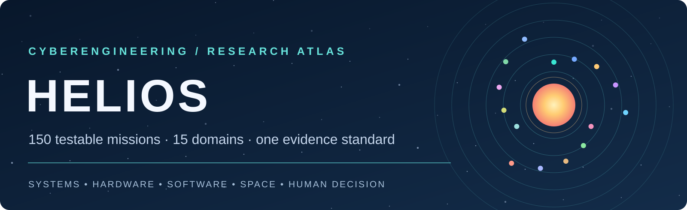
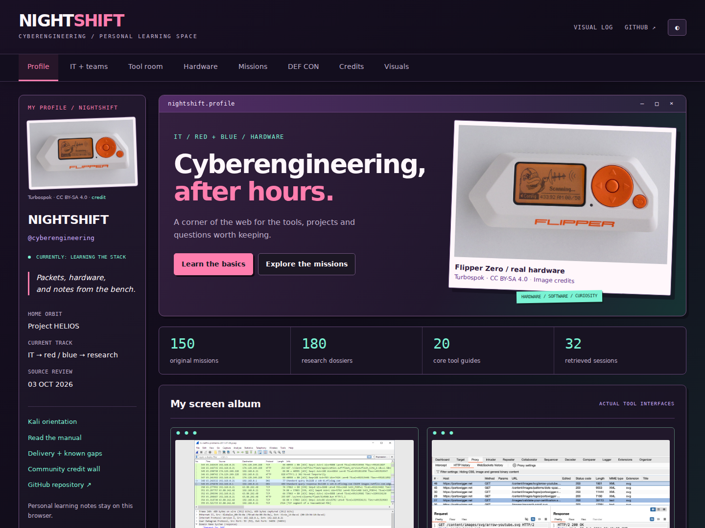
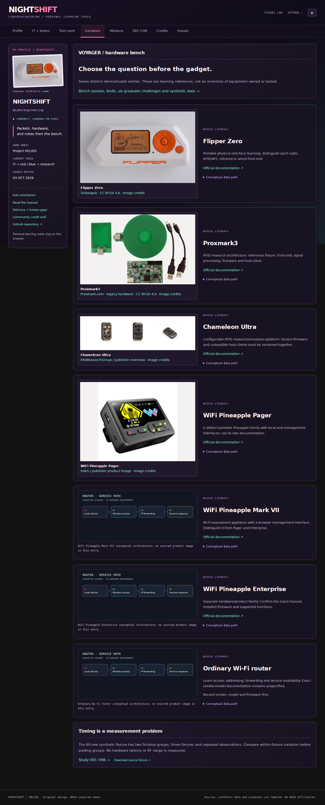
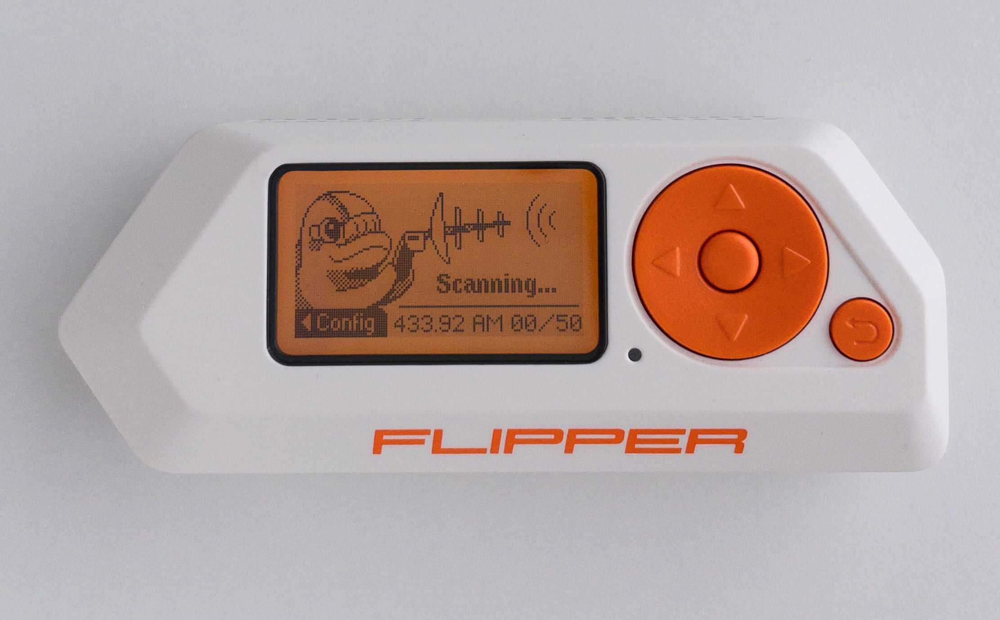
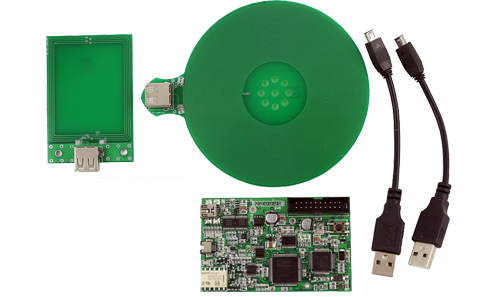
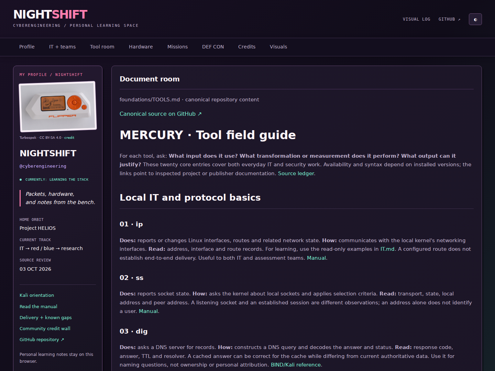
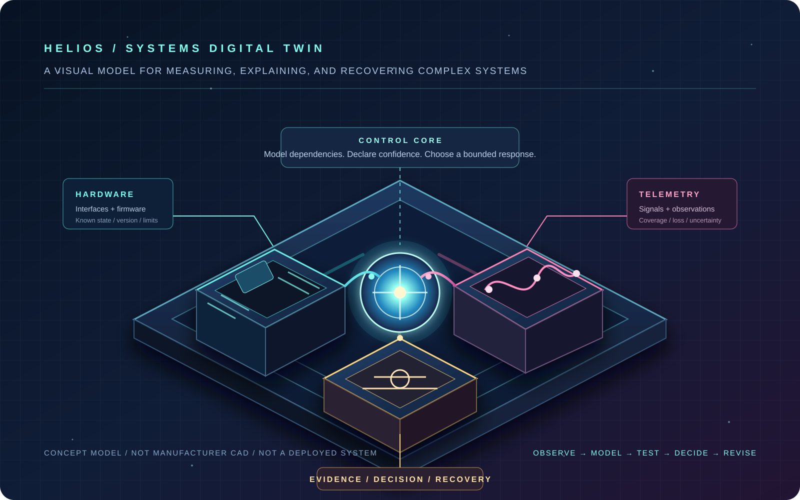
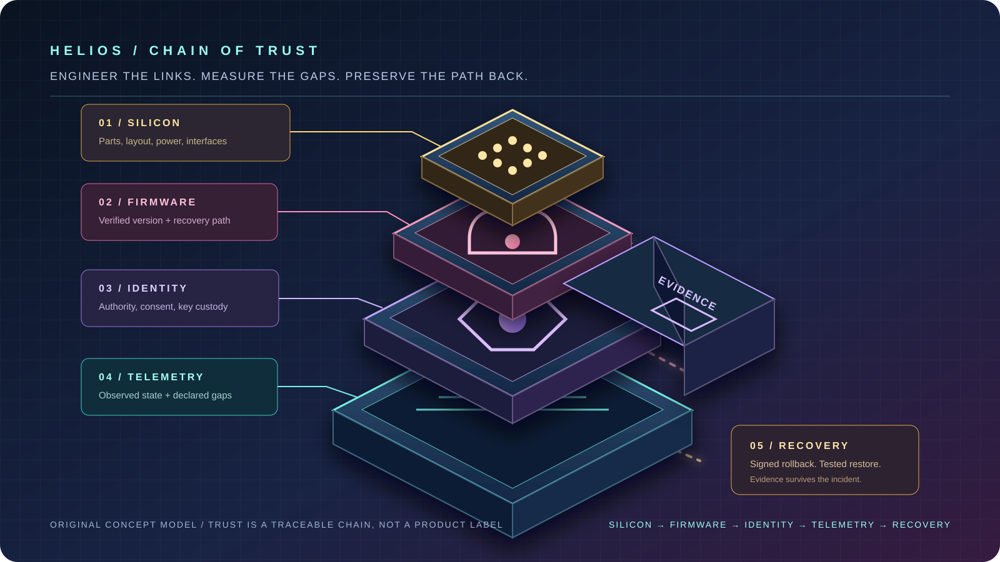
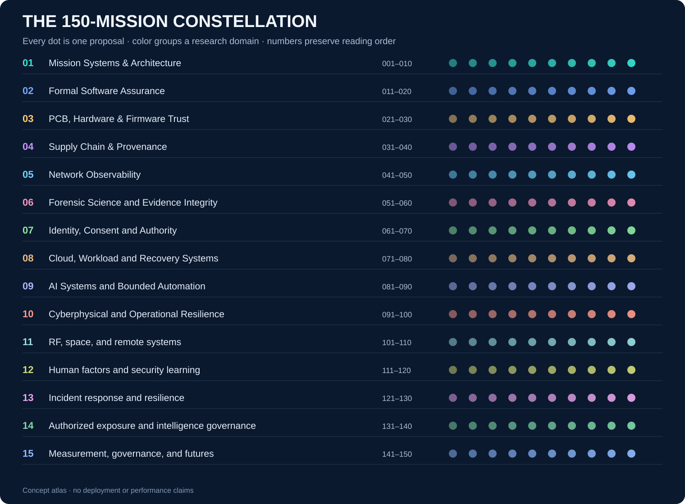
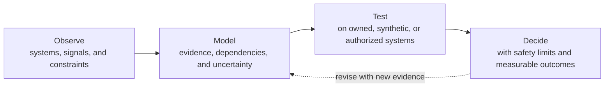

<p align="center">
  <a href="site/README.md">
    
  </a>
</p>

<h1 align="center">PROJECT HELIOS</h1>
<p align="center">
  <strong>A visual, evidence-aware cyberengineering atlas.</strong><br>
  Learn the systems behind secure software, trustworthy hardware, resilient networks, and responsible security research.
</p>

<p align="center">
  <a href="foundations/README.md"><strong>Start learning</strong></a>
  &nbsp;&bull;&nbsp;
  <a href="site/README.md"><strong>Open NIGHTSHIFT</strong></a>
  &nbsp;&bull;&nbsp;
  <a href="research/README.md"><strong>Explore research</strong></a>
  &nbsp;&bull;&nbsp;
  <a href="INDEX.md"><strong>Browse all missions</strong></a>
</p>

<p align="center">
  <a href="https://personfu.github.io/CyberEngineering/"><strong>Launch NIGHTSHIFT on GitHub Pages ↗</strong></a>
</p>

> **A research portfolio, not a deployed defense product.** Every exercise and proposal is scoped to owned, synthetic, or explicitly authorized systems. The work documents models, methods, and evaluation plans; it does not claim field effectiveness.

---

<!-- TOOL_REVIEWS_START -->
## Research, tools & practical engineering

**69 independently researched reviews · 65 primary documents · full product pages, firmware routes, walkthroughs and runnable labs.**

[Review and compare tools](site/reviews.html) · [Practical workbench](site/labs.html) · [Flashing and recovery](labs/FLASHING.md) · [Scripts and tests](labs/SCRIPTS.md) · [Source ledger](hardware/PRIMARY-SOURCES.md)

Each review contains cited features, our original assessment, choose/skip guidance, compatibility limits and alternatives. Walkthroughs connect tools to concrete tasks and expected results. The existing 150 missions, 180 research dossiers and 150 assessment modules remain intact.

### Bench & physical

| Product / workflow | Documentation and review |
| --- | --- |
| [FaultyCat v2.x hardware](hardware/reviews/faultycat.md) | A specialist electromagnetic/voltage fault-research tool with explicit hardware and firmware scope limits. |
| [FNIRSI LCR-ST2](hardware/reviews/lcr-st2.md) | A tweezer/Kelvin-capable component meter with selectable frequency and excitation rather than one universal accuracy figure. |

### Boards & firmware

| Product / workflow | Documentation and review |
| --- | --- |
| [ESP32-P4X-C5-Function-EV-Board](hardware/reviews/esp32-p4-c5-ev.md) | A two-chip multimedia development platform: P4 application processing paired with a C5 wireless module. |
| [ESP32-S31-Function-CoreBoard-1](hardware/reviews/esp32-s31-coreboard.md) | An Espressif development-board candidate for connected audio/AIoT prototyping, not a generic substitute for every ESP32. |
| [M5Stack Cardputer](hardware/reviews/cardputer.md) | A physical-keyboard embedded handheld with a model-specific input implementation. |
| [M5Stack Cardputer ADV](hardware/reviews/cardputer-adv.md) | A physical-keyboard embedded handheld with a model-specific input implementation. |
| [M5Stack Core2 (documented original model)](hardware/reviews/m5-core2.md) | A compact modular touchscreen controller whose original specification should not be silently applied to later revisions. |
| [M5Stack M5Paper (original model)](hardware/reviews/m5paper-original.md) | An original ESP32 e-paper terminal for information that benefits from persistence rather than rapid animation. |
| [M5Stack PaperS3](hardware/reviews/papers3.md) | A thin touch e-paper terminal with S3 resources and a revision-specific charging caveat. |
| [M5Stack Stamp-C5](hardware/reviews/stamp-c5.md) | A compact dual-band wireless module with a much smaller memory configuration than some C5 boards. |
| [M5Stack StickS3](hardware/reviews/sticks3.md) | A compact S3 controller with an audio/IR feature set whose power and interface constraints matter. |
| [M5Stack Tab5](hardware/reviews/tab5.md) | A touch-centric ESP32-P4 terminal with unusually broad built-in interfaces. |
| [Seeed XIAO ESP32-C5](hardware/reviews/xiao-c5.md) | A small dual-band Wi-Fi board with a different architecture and pin map from XIAO S3. |
| [Seeed XIAO ESP32-S3](hardware/reviews/xiao-s3.md) | A model-specific choice within Seeed’s small ESP32-S3 board family. |
| [Seeed XIAO ESP32-S3 Plus](hardware/reviews/xiao-s3-plus.md) | A model-specific choice within Seeed’s small ESP32-S3 board family. |
| [Seeed XIAO ESP32-S3 Sense](hardware/reviews/xiao-s3-sense.md) | A model-specific choice within Seeed’s small ESP32-S3 board family. |

### Cyberdecks & compute

| Product / workflow | Documentation and review |
| --- | --- |
| [ClockworkPi uConsole](hardware/reviews/uconsole.md) | A modular handheld whose exact core and operating-system image matter more than the shared enclosure name. |
| [HackberryPi CM5](hardware/reviews/hackberry-cm5.md) | A genuine Linux handheld built around CM5, with a useful keyboard and real expansion tradeoffs. |
| [Raspberry Pi 500](hardware/reviews/pi500.md) | A keyboard-integrated Linux workstation for a fixed bench, not a battery-powered pocket terminal. |
| [Raspberry Pi 500+](hardware/reviews/pi500-plus.md) | A keyboard-integrated Linux workstation for a fixed bench, not a battery-powered pocket terminal. |
| [Tanmatsu](hardware/reviews/tanmatsu.md) | An embedded terminal with a substantial display and keyboard, rather than a conventional Linux laptop. |

### Detection & privacy

| Product / workflow | Documentation and review |
| --- | --- |
| [nyanBOX](hardware/reviews/nyanbox.md) | A packaged ESP32/nRF24 wireless toolkit whose device-detection claims need their own validation. |

### Firmware & workflows

| Product / workflow | Documentation and review |
| --- | --- |
| [Armbian Build Framework](hardware/reviews/armbian.md) | A board-specific Linux image framework that is often more important than an SBC’s headline processor. |
| [Bruce](hardware/reviews/bruce.md) | A broad ESP32 firmware ecosystem with an explicit board/peripheral compatibility table. |
| [Cifertech ESP32-DIV](hardware/reviews/esp32-div.md) | A touchscreen multi-interface ESP32-S3 project whose broad functions depend on a complete hardware build. |
| [ESP32 Marauder](hardware/reviews/marauder.md) | A Wi-Fi/Bluetooth firmware and hardware ecosystem with explicit module-level hardware distinctions. |
| [GhostESP Revival](hardware/reviews/ghostesp.md) | An ESP-IDF-native platform with capture export, multiple front ends and an application ecosystem. |
| [HaleHound-CYD](hardware/reviews/halehound.md) | A touchscreen-focused CYD firmware whose expansion and power requirements are central to the build. |
| [Launcher (M5Stick-Launcher lineage)](hardware/reviews/launcher.md) | A firmware/partition manager that changes the ownership workflow rather than adding a new radio. |
| [Meshtastic firmware](hardware/reviews/meshtastic.md) | The software ecosystem behind many of the nodes, not a specification for one enclosure. |
| [POOM platform](hardware/reviews/poom.md) | An ESP-IDF application platform with maker, capture and interaction domains. |
| [Porkchop for Cardputer](hardware/reviews/porkchop.md) | A keyboard-oriented firmware whose memory budget and optional C5 coprocessor materially shape capabilities. |
| [RaspyJack](hardware/reviews/raspyjack.md) | A Raspberry Pi/Linux toolkit with local controls and web interfaces, not an ESP32 firmware image. |

### LoRa & navigation

| Product / workflow | Documentation and review |
| --- | --- |
| [Elecrow ThinkNode M1](hardware/reviews/thinknode-m1.md) | A model-specific mesh-node choice with a documented integration target. |
| [Elecrow ThinkNode M2](hardware/reviews/thinknode-m2.md) | A model-specific mesh-node choice with a documented integration target. |
| [Elecrow ThinkNode M3](hardware/reviews/thinknode-m3.md) | A model-specific mesh-node choice with a documented integration target. |
| [Elecrow ThinkNode M4](hardware/reviews/thinknode-m4.md) | A model-specific mesh-node choice with a documented integration target. |
| [Elecrow ThinkNode M5](hardware/reviews/thinknode-m5.md) | A model-specific mesh-node choice with a documented integration target. |
| [Elecrow ThinkNode M6](hardware/reviews/thinknode-m6.md) | A model-specific mesh-node choice with a documented integration target. |
| [Elecrow ThinkNode M7](hardware/reviews/thinknode-m7.md) | A model-specific mesh-node choice with a documented integration target. |
| [Elecrow ThinkNode M9](hardware/reviews/thinknode-m9.md) | A model-specific mesh-node choice with a documented integration target. |
| [Heltec Mesh Node T096](hardware/reviews/heltec-t096.md) | An individually documented nRF52840/SX1262 node configuration. |
| [Heltec Mesh Node T1](hardware/reviews/heltec-t1.md) | An individually documented nRF52840/SX1262 node configuration. |
| [Heltec Mesh Node T114](hardware/reviews/heltec-t114.md) | An individually documented nRF52840/SX1262 node configuration. |
| [Heltec WiFi LoRa 32 V4](hardware/reviews/heltec-v4.md) | A development-board mesh node whose exact V4 variant is critical. |
| [Heltec WiFi LoRa 32 V4-R8](hardware/reviews/heltec-v4-r8.md) | A development-board mesh node whose exact V4 variant is critical. |
| [Meshnology N37](hardware/reviews/meshnology-n37.md) | A packaged Wio Tracker L1-based node whose bill of materials is the useful buying distinction. |
| [Meshnology N39](hardware/reviews/meshnology-n39.md) | A Heltec WiFi LoRa 32 V4 package that needs careful base-board and revision verification. |
| [Seeed SenseCAP Solar Node P1](hardware/reviews/sensecap-p1.md) | A fixed outdoor solar node, with an important P1 versus P1 Pro package distinction. |
| [Seeed SenseCAP Solar Node P1 Pro](hardware/reviews/sensecap-p1-pro.md) | A fixed outdoor solar node, with an important P1 versus P1 Pro package distinction. |
| [Seeed Wio Tracker L1](hardware/reviews/wio-l1.md) | A distinct package in the nRF52840/SX1262 Wio Tracker L1 family. |
| [Seeed Wio Tracker L1 E-Ink](hardware/reviews/wio-l1-eink.md) | A distinct package in the nRF52840/SX1262 Wio Tracker L1 family. |
| [Seeed Wio Tracker L1 Lite](hardware/reviews/wio-l1-lite.md) | A distinct package in the nRF52840/SX1262 Wio Tracker L1 family. |
| [Seeed Wio Tracker L1 Pro](hardware/reviews/wio-l1-pro.md) | A distinct package in the nRF52840/SX1262 Wio Tracker L1 family. |

### RF accessories

| Product / workflow | Documentation and review |
| --- | --- |
| [PINGEQUA Hydra RF 424 Cap](hardware/reviews/hydra-rf-424.md) | A 433 MHz-oriented dual-radio expansion specifically for Cardputer ADV. |
| [PINGEQUA Hydra RF 824 Pro](hardware/reviews/hydra-rf-824.md) | A 868 MHz-oriented Cardputer ADV expansion, distinct from the 433 MHz Cap variant. |
| [PINGEQUA Hydra RF 924 Pro](hardware/reviews/hydra-rf-924.md) | A 915 MHz-oriented Cardputer ADV expansion, distinct from the 433 MHz Cap variant. |

### RFID & interfaces

| Product / workflow | Documentation and review |
| --- | --- |
| [Chameleon Lite](hardware/reviews/chameleon-lite.md) | A distinct Chameleon hardware version, reviewed separately from the Ultra. |
| [Chameleon Ultra](hardware/reviews/chameleon-ultra.md) | A dedicated RFID research/emulation candidate with several documented client choices. |
| [Chameleon Ultra Devkit](hardware/reviews/chameleon-devkit.md) | A distinct Chameleon hardware version, reviewed separately from the Ultra. |
| [Flipper Zero](hardware/reviews/flipper-zero.md) | A compact interface-learning platform with a documented firmware and external-application development workflow. |
| [KIISU SMOL](hardware/reviews/kiisu-smol.md) | A modular STM32WB55 platform with published schematics and a deliberately limited scope of open CAD material. |
| [Monstatek M1](hardware/reviews/monstatek-m1.md) | A multi-interface device with a documented STM32H5 architecture and an unusually important validation register. |
| [Proxmark3 RDV4](hardware/reviews/proxmark3-rdv4.md) | The more conservative host-driven RFID choice when reproducible analysis matters more than the newest silicon. |
| [Proxmark5](hardware/reviews/proxmark5.md) | An advanced RFID platform whose current software maturity makes it a developer purchase, not an automatic RDV4 upgrade. |

### SDR & signals

| Product / workflow | Documentation and review |
| --- | --- |
| [HackRF One](hardware/reviews/hackrf-one.md) | A broad-frequency SDR for experimentation, with explicit conversion and input-power limits. |
| [PortaPack H4M with Mayhem](hardware/reviews/portapack-h4m.md) | An on-device SDR interface whose usefulness depends on exact hardware and upstream firmware compatibility. |

### Wireless assessment

| Product / workflow | Documentation and review |
| --- | --- |
| [Cifertech nRFBox](hardware/reviews/nrfbox.md) | An ESP32/nRF24 toolkit whose own reliability table and power caveats deserve more attention than its feature count. |
| [JCMK ESP32 Dual Band Wardriver](hardware/reviews/dualband-wardriver.md) | A documented C5 survey/logging platform with meaningful board-variant and clean-install/update distinctions. |

[Research coverage](hardware/RESEARCH-COVERAGE.md) · [Review method](hardware/REVIEW-METHOD.md)

<!-- TOOL_REVIEWS_END -->

## Mission control

<table>
  <tr>
    <td width="50%" valign="top">
      <a href="site/README.md"></a>
      <h3><a href="site/README.md">NIGHTSHIFT: interactive learning portal</a></h3>
      <p>A custom static web experience with a visual profile, searchable missions and tools, a local field notebook, hardware models, conference coverage, and a diagram gallery.</p>
      <p><a href="site/README.md"><strong>Open the portal guide &rarr;</strong></a></p>
    </td>
    <td width="50%" valign="top">
      <a href="hardware/README.md"></a>
      <h3><a href="hardware/README.md">VOYAGER: hardware learning bench</a></h3>
      <p>Real hardware photographs sit beside conceptual architectures for device trust, RF work, firmware recovery, and reproducible bench measurements.</p>
      <p><a href="hardware/README.md"><strong>Visit the hardware bench &rarr;</strong></a></p>
    </td>
  </tr>
</table>

## Inside the lab

<table>
  <tr>
    <td width="33.33%" valign="top">
      <a href="hardware/README.md"></a>
      <h3><a href="hardware/README.md">Physical interfaces</a></h3>
      <p>Use real device imagery as a starting point for questions about interfaces, signals, firmware boundaries, and evidence limits.</p>
      <p><a href="hardware/README.md"><strong>Study the hardware model &rarr;</strong></a></p>
    </td>
    <td width="33.33%" valign="top">
      <a href="hardware/README.md"></a>
      <h3><a href="hardware/README.md">Signals to evidence</a></h3>
      <p>See how radio and RFID research is framed as authorized, reproducible observation rather than a collection of unexplained commands.</p>
      <p><a href="hardware/README.md"><strong>Open the bench protocol &rarr;</strong></a></p>
    </td>
    <td width="33.33%" valign="top">
      <a href="site/reader.html?doc=foundations/TOOLS.md"></a>
      <h3><a href="site/reader.html?doc=foundations/TOOLS.md">Tools with a purpose</a></h3>
      <p>Every field-guide entry explains its input, transformation, output, operating limit, and the manual or primary source behind it.</p>
      <p><a href="foundations/TOOLS.md"><strong>Read the tool field guide &rarr;</strong></a></p>
    </td>
  </tr>
</table>

<sub>Hardware photographs are credited in the <a href="site/IMAGE-CREDITS.md">image ledger</a>. They illustrate supported learning concepts; the repository does not provide unauthorized device-operation instructions.</sub>

## Your flight path

```text
01  FOUNDATION      Build vocabulary, inspect local systems, and learn to read manuals.
        |
02  OBSERVATION     Understand packets, devices, logs, and the limits of each measurement.
        |
03  ENGINEERING     Model trust, provenance, recovery, identity, and resilient operations.
        |
04  EVALUATION      Define a falsifier, measure a result, record uncertainty, and stop safely.
        |
05  RESEARCH        Connect a bounded mission to its evidence, sources, and graduate challenge.
```

| Flight phase | What you will be able to explain | Launch point |
| --- | --- | --- |
| `01 FOUNDATION` | The difference between an interface, protocol, service, process, packet, and claim | [MERCURY Foundations](foundations/README.md) |
| `02 OBSERVATION` | What a tool or device actually measures, and what it cannot establish | [Tool field guide](foundations/TOOLS.md) |
| `03 ENGINEERING` | How security constraints are designed into software, hardware, and operations | [Mission Systems & Architecture](atlas/01-mission-systems-and-architecture.md) |
| `04 EVALUATION` | How to turn a concept into an authorized, falsifiable experiment | [Research method](editorial/RESEARCH_METHOD.md) |
| `05 RESEARCH` | How advanced missions connect to models, resources, and open challenges | [Research Flightbook](research/README.md) |

| Begin with a question | Click through |
| --- | --- |
| **I am new to IT or security.** Learn the vocabulary, local HTTP, teams, tools, manuals, and six safe labs. | [MERCURY Foundations](foundations/README.md) |
| **I want to understand a device trust model.** Follow physical systems from PCB design through firmware recovery and provenance. | [Hardware & firmware trust](atlas/03-pcb-hardware-and-firmware-trust.md) |
| **I need an advanced research problem.** Use a falsifiable proposal with its data plan, guardrails, and evaluation criteria. | [Research Flightbook](research/README.md) |
| **I want a guided assessment progression.** Move from core concepts through authorized assessment engineering and graduate exercises. | [Assessment Flightbook](assessment/README.md) |
| **I want the complete map.** Browse every original mission in permanent reading order. | [150-mission index](INDEX.md) |

## See the engineering, not just the claims

<p align="center">
  <a href="site/gallery.html"></a>
</p>

<p align="center"><strong>HELIOS Systems Digital Twin</strong> &mdash; a Blender/Fusion-style reference model for the connected engineering layers in this atlas. <a href="site/gallery.html">Open the visual log &rarr;</a></p>

<p align="center">
  <a href="site/gallery.html"></a>
</p>

<p align="center"><strong>HELIOS Chain of Trust</strong> &mdash; a 3D engineering reference that makes every trust claim traceable from silicon to recovery. <a href="hardware/README.md">Open the hardware bench &rarr;</a></p>

<p align="center">
  <a href="site/gallery.html"></a>
</p>

<p align="center"><em>Click the model to open the visual gallery.</em></p>

The atlas connects evidence, uncertainty, dependencies, and decision-making instead of treating cybersecurity as a disconnected tool list:



**Explore the visual models:** [network observability](site/media/packet-path.svg) | [supply-chain provenance](site/media/provenance.svg) | [firmware trust](site/media/research/firmware.svg) | [recovery engineering](site/media/research/recovery.svg) | [full gallery](site/gallery.html)

## The atlas at a glance

| Portfolio | What it contains | Proof-oriented approach |
| :--- | :--- | :--- |
| **15 cyberengineering domains** | Architecture, formal assurance, hardware, provenance, networks, forensics, identity, cloud, AI, OT, RF, people, resilience, authorized exposure, and measurement | Every idea includes a mechanism, data plan, falsifier, and guardrail |
| **150 original mission proposals** | Ten permanently numbered missions per domain | [Open the indexed map](INDEX.md) |
| **180 research dossiers** | The original missions plus thirty NASA-inspired proposals, domain models, resource contracts, and graduate challenges | [Open the Research Flightbook](research/README.md) |
| **150 assessment modules** | A basic-to-advanced path for authorized red/blue-team assessment engineering | [Open the Assessment Flightbook](assessment/README.md) |
| **Custom learning software** | Search, filtering, bookmarks, browser-local notes, responsive layouts, and a document reader | [Explore NIGHTSHIFT](site/README.md) |

## Pick an orbit

Choose a system area, then drill into ten linked proposals. Mission numbers are permanent, so the atlas can be read linearly or entered from the domain closest to your work.

<!-- ATLAS_INDEX_START -->
| Orbit | Domain | Missions |
| :--- | :--- | :---: |
| 01 | [Mission Systems & Architecture](atlas/01-mission-systems-and-architecture.md) | 001–010 |
| 02 | [Formal Software Assurance](atlas/02-formal-software-assurance.md) | 011–020 |
| 03 | [PCB, Hardware & Firmware Trust](atlas/03-pcb-hardware-and-firmware-trust.md) | 021–030 |
| 04 | [Supply Chain & Provenance](atlas/04-supply-chain-and-provenance.md) | 031–040 |
| 05 | [Network Observability](atlas/05-network-observability.md) | 041–050 |
| 06 | [Forensic Science and Evidence Integrity](atlas/06-forensic-science.md) | 051–060 |
| 07 | [Identity, Consent and Authority](atlas/07-identity-privacy.md) | 061–070 |
| 08 | [Cloud, Workload and Recovery Systems](atlas/08-cloud-systems.md) | 071–080 |
| 09 | [AI Systems and Bounded Automation](atlas/09-ai-security.md) | 081–090 |
| 10 | [Cyberphysical and Operational Resilience](atlas/10-ot-resilience.md) | 091–100 |
| 11 | [RF, space, and remote systems](atlas/11-rf-space-remote-systems.md) | 101–110 |
| 12 | [Human factors and security learning](atlas/12-human-factors-learning.md) | 111–120 |
| 13 | [Incident response and resilience](atlas/13-response-resilience.md) | 121–130 |
| 14 | [Authorized exposure and intelligence governance](atlas/14-authorized-exposure-intelligence.md) | 131–140 |
| 15 | [Measurement, governance, and futures](atlas/15-measurement-governance-futures.md) | 141–150 |
<!-- ATLAS_INDEX_END -->

## High-value routes

| If you need to... | Start here | First credible result |
| --- | --- | --- |
| Model what fails next | [Function-First Risk Atlas](research/missions/001.md) and [Blast-Radius Digital Twin](research/missions/003.md) | An owned-service dependency model that predicts held-out incident consequences better than an asset-only baseline |
| Make hardware trust visible | [Trust-Visible PCB](research/missions/021.md) and [CAD-to-Fab Provenance Chain](research/missions/029.md) | A bench prototype with testable layout review, fabrication lineage, and interrupted-update recovery |
| Communicate uncertainty honestly | [Memory Snapshot Confidence Map](research/missions/051.md) and [Evidence-Bound Security Assistant](research/missions/081.md) | A synthetic case that distinguishes observed facts, unobservable gaps, and unsupported inference |
| Design for isolation or link loss | [Island-Mode Mission Test](research/missions/095.md) and [CubeSat Update Survival Model](research/missions/103.md) | An emulator or bench exercise measuring essential-function survival, rollback, and signed evidence delivery |
| Engineer measurable privacy | [Private Correlation Token](research/missions/066.md) and [Data-Minimization Twin](research/missions/070.md) | An approved data-flow experiment that quantifies retained utility against collected identity data |

## Evidence, safety, and reproducibility

- **Proposal, not result.** Citations ground design constraints; they are not evidence of achieved performance.
- **Authority is explicit.** RF, OT, spacecraft, and external-exposure studies require review before active trials.
- **Data stays controlled.** The repository excludes raw captures, memory dumps, executables, OSINT material, and personal records.
- **Failure matters.** Evaluations record false alarms, missing observations, operational cost, privacy impact, and stop conditions.

| Need the details? | Link |
| --- | --- |
| Research method and evidence threshold | [Editorial research method](editorial/RESEARCH_METHOD.md) |
| System campaign model | [System architecture](editorial/SYSTEM_ARCHITECTURE.md) |
| Source scope and provenance | [Source ledger](SOURCES.md) |
| Contribution standards | [Contributing guide](CONTRIBUTING.md) |
| Delivery register | [Delivery status](DELIVERY_STATUS.md) |
| Community and public-source directory | [ORION directory](community/README.md) |
| Bounded public intelligence research | [Public Intelligence desk](intelligence/README.md) |

## Run the custom portal locally

NIGHTSHIFT is a static site with no analytics, live hardware connection, or remote tool execution. It is published automatically to [GitHub Pages](https://personfu.github.io/CyberEngineering/) from `main`. Its notes, theme preference, and bookmarks stay in the current browser through local storage.

```bash
python scripts/build_site.py
python -m http.server 3000 --bind 127.0.0.1 --directory site
```

Then open [http://127.0.0.1:3000](http://127.0.0.1:3000). Use HTTP rather than `file://` so the local catalogs and document reader can load.

Validate the atlas and portal with:

```bash
python scripts/build_atlas.py --check
python scripts/build_site.py --check
python scripts/check_site.py
```
